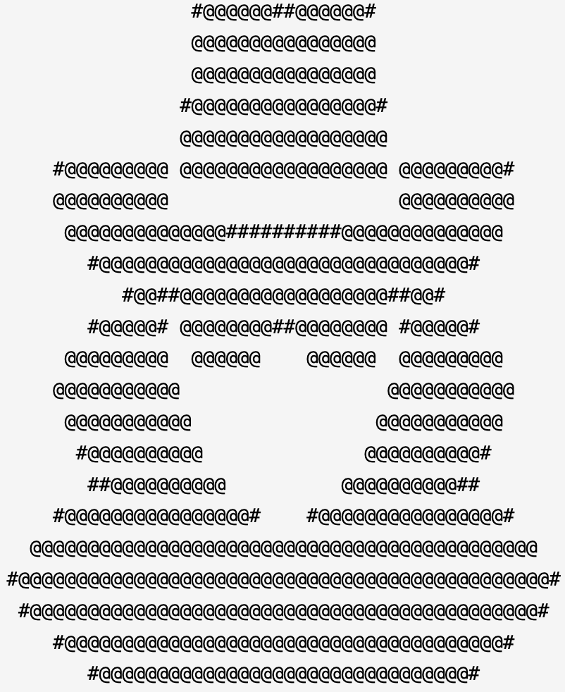

<div align="center">



# Uncle

**AI coding agents build the software. Uncle makes them prove their work.**

</div>

Uncle is an open-source, terminal-native development system that orchestrates Claude, Codex, local models, and other coding agents.

Describe an application or give Uncle a GitHub issue. It plans, implements, independently reviews, verifies, and prepares a pull request, with portable evidence tying the result to the code that was actually reviewed. You can watch a live preview as it builds and talk to it while it works.

**Build with the agents you already use. Verify without trusting their claims.**

## See Uncle in action

https://github.com/user-attachments/assets/5966ea18-5f58-418c-a0f3-c8415b68e354

## Quick start

You need at least one supported AI client installed and authenticated (Claude, Codex, Kimi, a self-hosted model, or AWS Bedrock). See [Prerequisites](PREREQUISITES.md).

**macOS / Linux / WSL** (Homebrew is required on macOS)

```sh
curl -fsSL https://raw.githubusercontent.com/unclehq/uncle/main/install.sh -o install.sh && bash install.sh
uncle --application 'build a groovy 1970s themed calculator react webapp with keyboard support' --attended
```

**Windows (PowerShell)** (Scoop is required)

```powershell
Invoke-WebRequest -UseBasicParsing https://raw.githubusercontent.com/unclehq/uncle/main/install.ps1 -OutFile install.ps1
powershell -NoProfile -ExecutionPolicy Bypass -File .\install.ps1
uncle --application 'build a groovy 1970s themed calculator react webapp with keyboard support' --attended
```

In an existing repository:

```sh
cd my-project
uncle
```

Give Uncle a `REQUIREMENTS.md`, a `CHANGE_REQUEST.md`, or a GitHub issue. You can also pipe a request in with `cat request.md | uncle --change-request`. Treat piped text as untrusted input to tool-using agents.

The commands above use `--attended`, which makes you approve each stage, because that is what produces a change that verifies. Without it, runs are unattended by default: a build goes straight through with no approval gates, every gate is recorded as delegated rather than approved by a person, and `uncle verify` refuses the result. That default exists so a demo can run hands-off. See [docs/UNATTENDED_DEFAULT_MIGRATION.md](docs/UNATTENDED_DEFAULT_MIGRATION.md). Windows support is newer than macOS and Linux.

## Help build Uncle

Uncle is an open-source project (MIT licensed) and we are looking for contributors. It is a small project, and early feedback has an outsized effect.

Whether you are interested in AI agents, developer tooling, software supply-chain security, or improving the developer experience, there are useful ways to get involved:

* New coding-agent and model integrations. A runner is one wrapper script that accepts `claude -p`-style flags; see `scripts/agent-codex.sh` and `scripts/agent-kimi.sh`.
* Tests, reliability and edge-case handling.
* Terminal UI and developer experience.
* Installation and platform compatibility, especially Windows.
* Documentation and examples. Stage prompts are Markdown files in `prompts/`.
* Integrity verification and portable attestations.

Small contributions and constructive criticism are welcome, including "this was confusing" and "this claim is not true". Start with [CONTRIBUTING.md](CONTRIBUTING.md), open an [issue](../../issues) for a concrete bug or request, or start a [discussion](../../discussions) for an idea.

## What makes Uncle different?

* **Independent review.** The agent implementing a change cannot approve its own implementation. Review is a separate stage run by a separate reviewer process, and you can point it at a different runner or model than the implementer. See [How Uncle works](#how-uncle-works).
* **Artifact identity.** Review, verification, approval and publication are tied to the relevant Git tree. See [The change is the unit of trust](#the-change-is-the-unit-of-trust).
* **Verifiable change provenance.** Uncle produces machine-readable evidence and portable attestations using established standards (in-toto, DSSE). See [Verifiable change provenance](#verifiable-change-provenance).
* **Model flexibility.** Use different supported runners and models for implementation, review and other stages: Claude, Codex, Kimi, self-hosted models, and AWS Bedrock ([docs/aws-bedrock.md](docs/aws-bedrock.md)).
* **Local-first operation.** Uncle runs on your machine in a terminal UI, with no Uncle-hosted backend, account or telemetry. Your model runners and GitHub still receive what they need to do the work; see the [privacy policy](PRIVACY_POLICY.md).

Limits worth knowing: the core drivers and `uncle_tui.py` are large, so changing the core takes more effort than changing prompts or config. Bedrock uses a bearer token, not an IAM role or SSO profile.

## The change is the unit of trust

Most coding tools focus on the agent doing the work. Uncle focuses on the **change**.

The coding agent is untrusted and swappable. A broken or careless agent cannot declare itself verified: the driver, not the agent, records the evidence. Defending against a hostile agent is harder. An unsigned attestation protects against mistakes, not against an agent that can write to the same filesystem, so that case requires a signing key the agent cannot reach (see [docs/verify.md](docs/verify.md)). Run agents in a sandbox if that matters to you.

For a change to be verified, the artifact that was reviewed, verified, approved and published must be the same artifact.

```text
Implementation       tree f12b8...
                         │
                         ▼
Independent review   tree f12b8...   PASS
                         │
                         ▼
Verification         tree f12b8...   PASS
                         │
                         ▼
Human approval       tree f12b8...
                         │
                         ▼
Publication          tree f12b8...

                         ✓
```

If the code changes after review:

```text
Review               tree f12b8...   PASS
Verification         tree f12b8...   PASS
Publication          tree 91ae3...

                         ✗
                    NOT VERIFIED: tree changed after review
```

The review may have been valid. It just was not a review of the code being published. Uncle treats that distinction as an invariant.

This does not mean the software is correct. It means the process Uncle claims to have followed was followed on the code you have.

## Verifiable change provenance

Each completed change gets a machine-readable attestation: an [in-toto](https://in-toto.io/) Statement wrapped in a DSSE envelope, written by Uncle's driver from its own records and never by a model. It binds the requirements, the approved plan, the implementation tree, the review and verification results, and the human approvals to the tree that was published.

```sh
uncle verify          # the current checkout
uncle verify 123      # a pull request
```

`uncle verify` checks that the tree you have matches the attestation, that the review, verification and audit stages recorded a pass, and that required gates were approved by a person. The verifier is a single Python file that needs only `git`, so you can check a change without installing Uncle; see [docs/verify.md](docs/verify.md).

Its result says four different things, and they should not be confused:

| Guarantee | What it means | Covered by `uncle verify`? |
|---|---|---|
| Artifact integrity | The tree is the one that was reviewed, verified and approved. | Yes |
| Signature authenticity | A key you trust signed the attestation. | Only with a trust root you supply. Without one, the result is integrity only (exit 3). |
| Review and verification evidence | The stages recorded a pass and people approved. | Yes, as a record of what Uncle observed. |
| Software correctness | The code works and is secure. | No. |

Exit codes at a glance: `0` verified, `1` not verified, `2` usage error, `3` integrity only. Signing, the full check list and the exit codes are in [docs/verify.md](docs/verify.md).

## Talk to Uncle while it works

Uncle is not a fire-and-forget coding agent. You can ask what the current stage is doing, add context, redirect the implementation, or discuss a failure, all from the terminal.

```text
You    "Why is this taking so long?"
Uncle  explains the current state

You    "Have it use the existing parser instead."
Uncle  steers the active worker
```

The supervisor can observe, explain, diagnose and steer work. It cannot silently grant itself the authority to waive integrity requirements or publish a change. See [docs/supervision.md](docs/supervision.md).

## How Uncle works

**Delegate the work, not the responsibility.**

```text
GitHub issue / requirements
            │
            ▼
           Plan
            │
            ▼
      Human approval
            │
            ▼
      Implementation
            │
            ▼
    Independent review
            │
            ▼
       Verification
            │
            ▼
      Human approval
            │
            ▼
        GitHub PR
```

Uncle works inside your existing repository and with your existing tools. It does not replace your IDE, your coding agents, GitHub or CI. The terminal is the interface, the change is the unit of work, agents are workers, and GitHub stays the system of record. In unattended mode the human-approval steps are delegated and recorded as such.

## Uncle builds Uncle

Uncle is developed with Uncle. Much of the work in this repository starts as an issue and goes through the same plan, review, verification and pull request flow that Uncle provides to other projects, and some of its pull requests carry a change attestation (`.uncle/attestation.json`). You can check one yourself with `uncle verify <PR number>`.

Not every pull request here carries an attestation, and not every one verifies today: the attestation committed here has no signature and there is no trust root, and a change built unattended is refused by design. Some changes are also committed directly. That is the current state, and closing the gap is open work.

## GitHub integration

Uncle can start from a GitHub issue and carry the change through planning, implementation, review, verification and publication. It uses your existing `gh` authentication (`gh auth login`).

In attended mode, Uncle shows you the audited diff and asks for approval before it creates the commit, branch, push and pull request. In unattended mode it publishes the pull request itself, as a draft when the final audit is not READY. Either way Uncle stops at the pull request, and your normal GitHub review, CI and merge controls remain the final authority. See [GitHub integration](GITHUB_INTEGRATION.md).

## Documentation and advanced usage

* [Quickstart](docs/quickstart.md) and [Prerequisites](PREREQUISITES.md)
* [Verifying a change](docs/verify.md): `uncle verify`, signing, checks and exit codes
* [Running without the TUI](docs/noui.md): `--noui`, exit codes, signals
* [Supervision and recovery](docs/supervision.md): supervision settings, triage, the home chat agent, stdin input
* [Two issues on one project](docs/worktrees.md): git worktrees
* [Change plan duties](docs/plan-duties.md)
* [AWS Bedrock runner](docs/aws-bedrock.md)
* [Unattended default migration](docs/UNATTENDED_DEFAULT_MIGRATION.md)
* [GitHub integration](GITHUB_INTEGRATION.md)
* [Release provenance](ATTESTATIONS.md): GitHub Actions build provenance for release artifacts, a separate topic from change attestations
* [Script reference](scripts/README.md)
* [Contributing](CONTRIBUTING.md), [Security](SECURITY.md), [Privacy policy](PRIVACY_POLICY.md), [Code of conduct](CODE_OF_CONDUCT.md), [License](LICENSE)

## Project author and contributors

Uncle was started by Brian Woods ([@brianosaurus](https://github.com/brianosaurus)) and has had contributions from other people. The full list is on the [contributors page](https://github.com/unclehq/uncle/graphs/contributors).

## Ideas and feedback

Have an idea or want to discuss how Uncle should work? Start a [GitHub Discussion](../../discussions). Found a bug or have a concrete request? Open an [issue](../../issues).

Ideas start in Discussions. Work starts in Issues. Uncle takes it from there.
